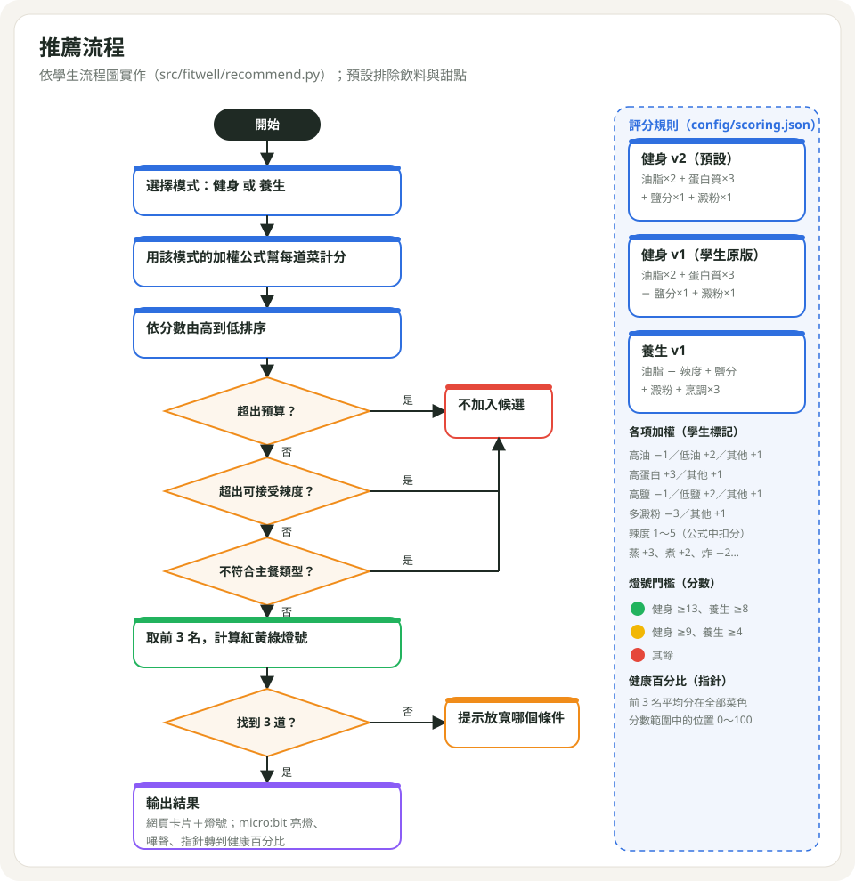
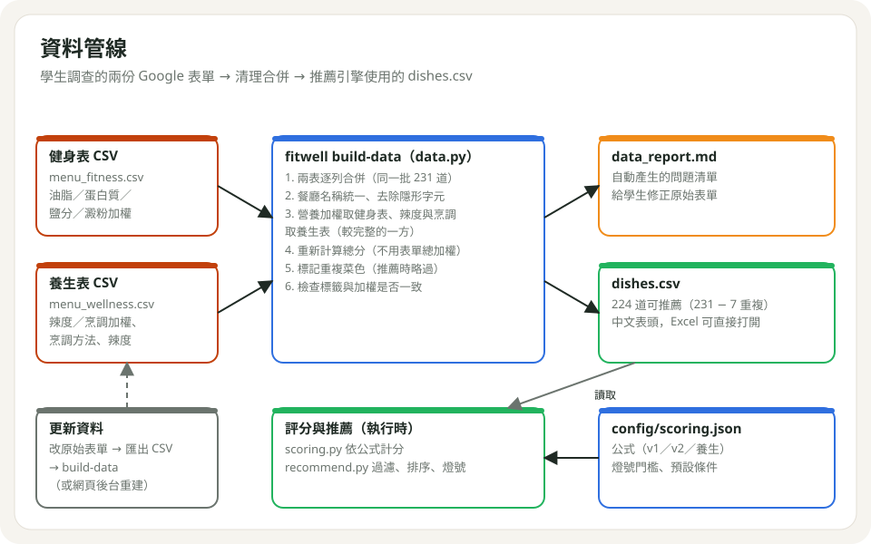
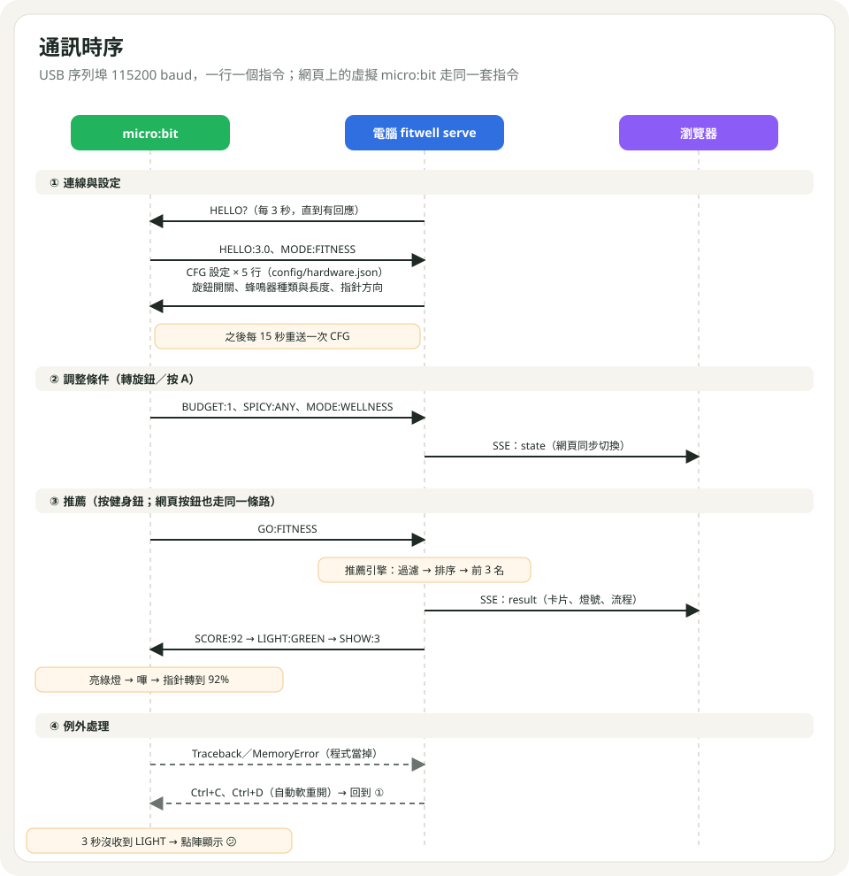

# 系統架構與原理

> 操作步驟見 [MANUAL.md](MANUAL.md)。本文件說明系統如何組成、推薦怎麼算、各部分如何溝通。

## 1. 設計原則

1. **micro:bit 只做輸入與輸出**：按鈕、旋鈕、燈號、聲音、指針。資料、計算、AI 都在電腦上，改資料或公式不用重新燒錄。
2. **硬體全部選用、逐步疊加**：基本電路只需三顆 LED；其他零件沒接時程式自動略過。
3. **設定與程式分離**：公式、門檻、零件開關都寫在設定檔，學生改數字即可。
4. **網頁與硬體共用同一份狀態**：在網頁選條件、在 micro:bit 按推薦，結果一致。

## 2. 系統架構

| 層 | 組成 | 職責 |
|---|---|---|
| 硬體 | micro:bit、LED、按鈕、旋鈕、伺服馬達、蜂鳴器 | 讀取輸入、顯示結果 |
| 電腦 | Python（FastAPI）`fitwell serve` | 序列埠橋接、機台狀態、評分、推薦、AI、網頁 API |
| 瀏覽器 | `web/`（HTML／CSS／JS，免編譯） | 展示畫面、虛擬 micro:bit |
| 雲端（選用） | Gemini API（Interactions） | 自然語言需求理解與推薦說明 |
| 資料 | CSV、JSON 設定檔 | 菜單、公式、零件設定 |

## 3. 推薦演算法

### 3.1 計分

每道菜有六項加權（由學生依標籤標記）：

| 項目 | 規則 |
|---|---|
| 油脂 | 高油 −1、低油 +2、其他 +1 |
| 蛋白質 | 高蛋白質 +3、其他 +1 |
| 鹽分 | 高鹽 −1、低鹽 +2、其他 +1 |
| 澱粉 | 多澱粉 −3、其他 +1 |
| 辣度 | 不辣 1、其他為辣度等級 1～5 |
| 烹調 | 蒸 +3、水煮／煮 +2、烤／炒／生食 +1、炸 −2、飲品 −2 |

分數 = Σ（加權 × 公式倍數），公式定義在 `config/scoring.json`：

| 公式 | 算式 | 說明 |
|---|---|---|
| `fitness_v2`（預設） | 油脂×2 + 蛋白質×3 + 鹽分×1 + 澱粉×1 | 健身：高蛋白、低油 |
| `fitness_v1` | 油脂×2 + 蛋白質×3 − 鹽分×1 + 澱粉×1 | 學生原版（鹽分方向相反，保留供比較） |
| `wellness_v1`（預設） | 油脂 − 辣度 + 鹽分 + 澱粉 + 烹調×3 | 養生：清淡、少辣 |

### 3.2 篩選與排序

依序：計分 → 依分數排序（同分時辣度低、價格低優先）→ 預算上限 → 可接受辣度 → 主餐類型（未指定時排除飲料、甜點）→ 取前 3 名。

不足 3 道時，分別試著放寬「預算一級」「辣度一級」「類型不限」，回報各自可多找到幾道。

### 3.3 輸出

| 輸出 | 計算方式 |
|---|---|
| 紅黃綠燈 | 前 3 名平均分與門檻比較（健身 v2：綠 ≥13、黃 ≥9；養生：綠 ≥8、黃 ≥4） |
| 健康百分比（指針） | 平均分在全部菜色分數範圍中的位置，0～100 |
| 分數拆解 | 每一項「加權 × 倍數」，顯示在卡片上 |

### 3.4 我的餐盤

多道菜的平均分決定燈號；另依整餐組成提出警告：2 道以上高油、高鹽或多澱粉，健身模式沒有高蛋白質，養生模式含辣度 ≥3 的菜。2 個警告最多黃燈，3 個以上為紅燈。

## 4. 資料管線

| 項目 | 數量 |
|---|---|
| 餐廳 | 12 家（竹北遠百） |
| 菜色 | 231 筆，不重複 224 道 |
| 主餐類型 | 12 類 |

合併規則：營養加權（油脂、蛋白質、鹽分、澱粉）取健身表；辣度、烹調方法與加權取養生表；餐廳名稱統一；表單上的總加權不採用，一律由公式重算。`fitwell build-data` 同時輸出 `data_report.md`，列出重複、標籤與加權矛盾、總分算錯等問題供修正原始表單。

`dishes.csv` 欄位：編號、餐廳、餐點名稱、價格區間、主餐類型、烹調方法、辣度、口感、健康標籤、油脂／蛋白質／鹽分／澱粉／辣度／烹調加權、重複於。

## 5. 通訊協定

USB 序列埠，115200 baud，一行一個指令（`\n` 結尾）。網頁上的虛擬 micro:bit 呼叫 `POST /api/microbit/simulate`，走同一套指令。

**micro:bit → 電腦**

| 指令 | 意義 |
|---|---|
| `HELLO:3.0` | 開機或回應 `HELLO?`（韌體版本） |
| `MODE:FITNESS`／`MODE:WELLNESS` | 切換模式 |
| `GO`／`GO:FITNESS`／`GO:WELLNESS` | 推薦（後兩者同時切換模式） |
| `BUDGET:0`～`3`、`BUDGET:ANY` | 預算：100以下、101-300、301-500、500以上、不限 |
| `SPICY:0`～`5`、`SPICY:ANY` | 可接受辣度：不辣～5、都可以 |
| `WARN:MEMORY …` | 記憶體不足，已自動整理並繼續執行 |

**電腦 → micro:bit**

| 指令 | 意義 |
|---|---|
| `HELLO?` | 詢問程式是否在執行（連上前每 3 秒一次） |
| `CFG:KNOB:0/1`、`CFG:SKNOB:0/1`、`CFG:BUZZER:passive/active/off`、`CFG:SERVO_REV:0/1`、`CFG:BEEP:毫秒` | 零件設定（腳位不經指令傳送，產生 .hex 時依 `pins` 寫進程式），收到 `HELLO` 後送出，之後每 15 秒重送 |
| `SCORE:0`～`100` | 健康百分比（接著的 `LIGHT` 會用來轉指針） |
| `LIGHT:GREEN/YELLOW/RED/OFF` | 燈號；micro:bit 先播聲音再轉指針 |
| `SHOW:文字` | 點陣顯示 |
| `ACK:…` | 收到指令（可忽略） |

可靠性機制：收到 micro:bit 程式回應才算「已連接」；Mac 上偵測瀏覽器以 WebUSB 佔用 micro:bit 並提示；micro:bit 輸出 Traceback／Error 時自動軟重開；每 15 秒重送設定，micro:bit 重開後自動恢復。

## 6. 硬體設計

| 限制 | 設計對策 |
|---|---|
| V1 的 5×5 點陣佔用 P3、P4、P6、P7、P9、P10；A／B 鍵佔 P5、P11 | 自由腳位 P0～P2、P8、P12～P16 分給 LED、按鈕、伺服馬達、蜂鳴器 |
| 可讀類比值的腳位只有 P0～P4、P10 | 旋鈕接 P4、P10，讀取前暫時關閉點陣，並串 10kΩ 保護腳位 |
| V1 聲音預設從 P0 輸出（P0 是綠燈） | 聲音改從 P16 輸出 |
| V1 的聲音與伺服馬達共用 PWM 時脈 | 先播聲音、再設定伺服馬達的 20ms 週期 |
| 蜂鳴器音量受 3.3V 驅動限制 | 音高選在蜂鳴器共振頻率附近（約 2～3kHz），每聲長度可由 `beep_ms` 調整 |
| 按鈕可能沒接 | 啟用內部上拉，沒接時恆讀到 1，不會誤觸 |
| 伺服馬達啟動電流大 | 獨立電池供電、共地 |
| V1 記憶體 16KB（MicroPython 執行後約剩 5KB） | 韌體只保留輸入輸出；主迴圈拆成小函式；預先建立常用資料；記憶體不足時整理後繼續執行；V1 使用 MicroPython v1.0.1 打包的 .hex |

韌體版本：`firmware/microbit/main.py`（MicroPython，V1 以 `fitwell-microbit-v1.hex` 發布）與 `makecode.ts`（MakeCode，編譯成機器碼，不受 MicroPython 記憶體限制）。

## 7. 軟體結構

| 模組（`src/fitwell/`） | 職責 |
|---|---|
| `data.py` | 讀取、合併、檢查原始表單，輸出 `dishes.csv` 與報告 |
| `scoring.py` | 依公式計分、拆解、判斷燈號 |
| `recommend.py` | 篩選、排序、前 N 名、放寬建議、健康百分比、餐盤評估 |
| `config.py` | 讀取 `scoring.json`、`hardware.json`，轉成 CFG 指令 |
| `serial_bridge.py` | 序列埠偵測、握手、讀寫、當機偵測與自動重開 |
| `ai_coach.py` | 需求解析（Gemini 或關鍵字規則）、從候選菜中挑選並說明 |
| `server.py` | FastAPI：REST API、SSE 事件、機台狀態、micro:bit 指令處理、定期重送設定 |
| `cli.py` | `serve`、`build-data`、`recommend`、`monitor`、`ports` |

| API | 用途 |
|---|---|
| `GET /api/meta`、`GET /api/status` | 選項、公式、連線與設定狀態 |
| `GET／POST /api/state` | 讀取／修改機台狀態 |
| `POST /api/go`、`POST /api/recommend` | 依機台狀態推薦／自訂條件推薦 |
| `GET /api/dishes` | 全部菜色與分數 |
| `POST /api/tray` | 餐盤評估 |
| `POST /api/coach` | AI 小教練 |
| `GET /api/events` | SSE：status、state、result、microbit、tray |
| `POST /api/microbit/simulate`、`/send` | 虛擬 micro:bit、除錯送指令 |
| `POST /api/admin/rebuild`、`GET /api/report` | 重建資料、資料報告 |

## 8. 部署

| 情境 | 做法 |
|---|---|
| 展示現場 | 筆電執行 `fitwell serve`，micro:bit 接 USB，瀏覽器全螢幕 |
| 平板當螢幕 | 筆電與平板同一網路，平板開啟 `http://<筆電 IP>:8000` |
| 雲端（無硬體） | `docker build -t fitwell .`，以 `FITWELL_NO_SERIAL=1` 執行，只用虛擬 micro:bit |

## 9. 擴充方向

### 9.1 個人帳號與每日飲食規劃

目前「我的餐盤」是單次組合評估，存在瀏覽器本機。延伸為每日規劃：

| 元件 | 說明 |
|---|---|
| 使用者 | 暱稱或班級代碼登入（校園場域不收集姓名、生日等個資）；目標：增肌、減脂、銀髮養生 |
| 每日紀錄 | 早／午／晚／點心各一個餐盤，存於伺服器資料庫（SQLite → 雲端 PostgreSQL） |
| 每日額度 | 依目標設定一天的油脂、鹽分、澱粉上限（以加權總和計），即時顯示剩餘額度 |
| 週報 | 一週燈號分布、最常吃的類型、改善建議 |

### 9.2 與 AI 結合

| 功能 | 做法 |
|---|---|
| 下一餐建議 | 把當天已吃的餐盤與剩餘額度交給 Gemini，限定只能從 `dishes.csv` 挑選，補足當天缺少的（例如蛋白質不足、鹽分已超標） |
| 每日回顧 | 晚上自動產生一段給學生看的回饋與明天的建議 |
| 自動標註新菜 | 輸入新餐廳菜名，AI 建議健康標籤與加權，人工確認後加入資料庫，換一家百貨公司也能快速建立資料 |
| 語音點餐 | 瀏覽器語音辨識 → AI 小教練，方便長輩使用 |

原則：AI 只在資料庫內挑選並解釋，不自行產生營養數字；最終加權仍由人工確認。

### 9.3 硬體

| 需求 | 建議 |
|---|---|
| 更多零件或功能（燈環、更多感測器） | 改用 MakeCode 韌體或 micro:bit V2，即無記憶體限制 |
| 點餐單 | 熱感應出單機列印推薦結果 |
| 會員卡 | RFID 卡片代表不同目標，刷卡套用 |
