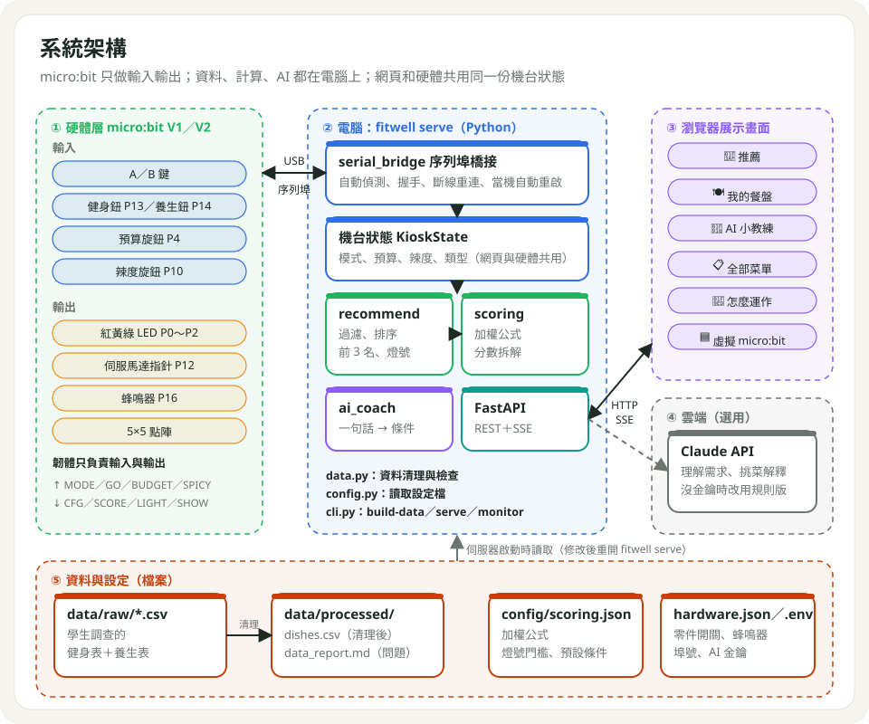
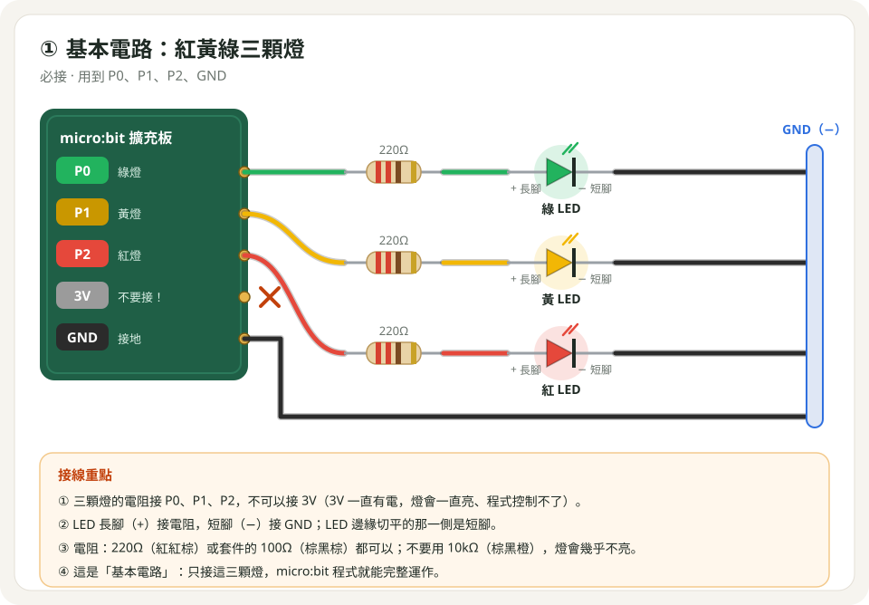
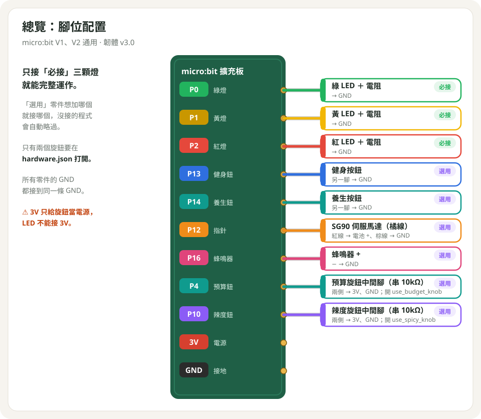

# 操作手冊

> 從零開始組裝、燒錄、啟動與展示「Fit & Well 點餐導航」。系統原理見 [ARCHITECTURE.md](ARCHITECTURE.md)。



## 1. 材料

| 類別 | 零件 | 規格 | 數量 | 必要性 |
|---|---|---|---|---|
| 主控 | micro:bit | V1 或 V2 | 1 | 必要 |
| 主控 | USB 線 | Micro-USB，**可傳資料** | 1 | 必要 |
| 主控 | 擴充板 | KittenBot IOBIT V2.0 或 ELECFREAKS Breadboard Adapter | 1 | 必要 |
| 基本電路 | LED | 5mm 紅、黃、綠 | 各 1 | 必要 |
| 基本電路 | 電阻 | 100Ω～220Ω | 3 | 必要 |
| 加分 | 按鈕 | 輕觸按鈕（2 腳或 4 腳） | 2 | 選用 |
| 加分 | 伺服馬達 | SG90／EF92A（180°） | 1 | 選用 |
| 加分 | 電池盒 | 2～3 顆 AA | 1 | 接伺服馬達時必要 |
| 加分 | 蜂鳴器 | 無源（類比）或有源（數位） | 1 | 選用 |
| 加分 | 可變電阻 | B10K，3 腳 | 2 | 選用（預算、辣度旋鈕各 1） |
| 加分 | 電阻 | 10kΩ | 2 | 接旋鈕時必要 |
| 電腦 | 筆電 | macOS／Windows，可安裝 Python 3.10+ | 1 | 必要 |

ELECFREAKS micro:bit Starter Kit 內含上表除 micro:bit、電腦外的零件，但**可變電阻只有 1 顆**，要做兩個旋鈕需另購 1 顆。

## 2. 安裝電腦端程式

電腦只需要 **uv**（它會自動下載正確版本的 Python）。不需要另外安裝 Python、Node.js 或任何驅動程式（Windows 10／11、macOS 都內建 micro:bit 的 USB 序列埠驅動）。

### 2.1 Windows 10／11（全新電腦）

1. **複製專案**：把整個專案資料夾複製到電腦，例如 `C:\fitwell`（路徑盡量不要有中文或空白）。
2. **開啟 PowerShell**：開始選單搜尋「PowerShell」→ 開啟（不需要系統管理員）。
3. **安裝 uv**（官方安裝指令，裝在使用者資料夾，不影響系統）：
   ```powershell
   powershell -ExecutionPolicy ByPass -c "irm https://astral.sh/uv/install.ps1 | iex"
   ```
   裝完**關掉 PowerShell 再重開一次**，輸入 `uv --version` 有出現版本號就成功。
4. **安裝專案需要的套件**（第一次需要網路，約 1～2 分鐘）：
   ```powershell
   cd C:\fitwell
   uv sync --all-extras
   ```
5. **插上 micro:bit 確認偵測得到**：
   ```powershell
   uv run fitwell ports
   ```
   會看到類似 `COM3  mbed Serial Port` 的一行。
6. **啟動**：
   ```powershell
   uv run fitwell serve
   ```
   第一次啟動若跳出「Windows 安全性警示（防火牆）」：只在這台電腦上用就按「取消」也沒關係；要讓同網路的平板連進來才選「允許（私人網路）」。
7. 用 Edge 或 Chrome 開啟 http://localhost:8000 ，按 F11 全螢幕。

> 展場沒有網路也能用：第 4 步裝好之後，啟動與網頁都不需要網路（字型、圖示、動畫都放在專案裡）；只有 AI 小教練會自動改用規則版。

### 2.2 macOS

```bash
curl -LsSf https://astral.sh/uv/install.sh | sh   # 安裝 uv（裝完重開終端機）
cd 專案資料夾
uv sync --all-extras
uv run fitwell serve
```

### 2.3 電腦端設定（選用）

埠號、指定序列埠（例如 Windows 的 `COM3`）、AI 金鑰寫在 `.env`，範本見 `.env.example`；不建立也能使用。

## 3. 接線

### 3.1 基本電路（必接）



- LED 長腳（+）接電阻，短腳（−）接 GND。
- **LED 不可接 3V**：3V 是常時供電，燈會一直亮、程式無法控制。
- 使用 IOBIT 時，板上 **P0 蜂鳴器開關要撥到「關」**（P0 接了綠燈）。

### 3.2 加分零件（選用）

沒接的零件程式會自動略過；只接基本電路即可完整運作。

**擴充板或接法不同時**：腳位寫在 `config/hardware.json` 的 `pins`。改好數字後，執行 `uv run python scripts/build_microbit_hex.py` 重新產生 `.hex` 並燒錄（腳位會直接寫進程式；V1 記憶體不夠在執行中換腳位）。下表是預設腳位：

| 名稱（`pins` 裡的鍵） | 零件 | 預設 | 可以改成 |
|---|---|---|---|
| `green`、`yellow`、`red` | 綠、黃、紅燈 | P0、P1、P2 | 0、1、2、8、12～16 |
| `fitness_button`、`wellness_button` | 健身、養生鈕 | P13、P14 | 0、1、2、8、12～16 |
| `servo` | 伺服馬達 | P12 | 0、1、2、8、12～16 |
| `buzzer` | 蜂鳴器 | P16 | 0、1、2、8、12～16 |
| `budget_knob`、`spicy_knob` | 預算、辣度旋鈕 | P4、P10 | 0、1、2、3、4、10（要能讀類比） |

規則：同一隻腳只能接一個零件；3、4、6、7、9、10 是點陣的腳位，只能接旋鈕；5、11（A／B 鍵）、19、20 不能用。設定錯誤時產生 `.hex` 的指令會直接說明哪裡錯。

> 下面的接線圖都以預設腳位繪製。



| 零件 | 腳位 | 接線圖 | 設定（`config/hardware.json`） |
|---|---|---|---|
| 健身／養生按鈕 | P13、P14，另一腳 GND | [02](images/wiring/02_buttons.svg) | — |
| 伺服馬達指針 | 橘 P12、棕 GND、紅 電池 + | [03](images/wiring/03_servo.svg) | `servo_reverse` |
| 蜂鳴器 | + P16、− GND | [05](images/wiring/05_buzzer.svg) | `buzzer`、`beep_ms` |
| 預算旋鈕 | 中間腳 → 10kΩ → P4；兩側 3V、GND | [06](images/wiring/06_budget_knob.svg) | `use_budget_knob: true` |
| 辣度旋鈕 | 中間腳 → 10kΩ → P10；兩側 3V、GND | [07](images/wiring/07_spicy_knob.svg) | `use_spicy_knob: true` |

- **伺服馬達**用電池盒供電，電池盒 − 與 micro:bit GND 共地；不要接 micro:bit 3V 或 IOBIT 5V（啟動電流會讓系統重開或斷電）。
- **旋鈕一定要串 10kΩ**：P4、P10 同時是點陣腳位，直接相接可能損壞 micro:bit。
- 4 腳按鈕跨在麵包板中間凹槽上，取對角線兩腳。

## 4. 燒錄 micro:bit

依 micro:bit 版本選擇（背面晶片旁印有 V1／V2，或 V2 有麥克風孔），功能與電腦溝通方式完全相同：

| 程式 | 檔案 | 適合 | 說明 |
|---|---|---|---|
| **MicroPython .hex**（已實機測試） | `firmware/microbit/fitwell-microbit-v1.hex` | **V1** | 拖曳燒錄，不用開網頁 |
| MicroPython（網頁燒錄） | `firmware/microbit/main.py` | V2 | 到 https://python.microbit.org 貼上 `main.py` → Send to micro:bit；V2 記憶體較大，沒有 V1 的記憶體問題 |
| MakeCode（實驗性） | `firmware/microbit/makecode.ts` | **只建議 V2** | 學生可切成積木看程式。**V1 實機測試會當機**：開啟旋鈕或按外接按鈕約 13 秒後重開 |

### 4.1 拖曳 .hex（Windows／macOS 相同，最簡單）

1. 用 USB 線接上 micro:bit，電腦會出現名為 **MICROBIT** 的隨身碟。
2. 把 `fitwell-microbit-v1.hex` 拖進 **MICROBIT**（Windows：檔案總管；macOS：Finder）。
3. micro:bit 背面黃燈閃爍約 10 秒，完成後自動重開：三顆燈依序亮、嗶一聲、點陣顯示 `F`。

不要用 python.microbit.org 燒錄 V1：網頁版的 MicroPython 比較新、可用記憶體更少，V1 很容易出現 `WARN:MEMORY`。

### 4.2 MakeCode（實驗性，只建議 V2）

1. 用 Edge 或 Chrome 開啟 https://makecode.microbit.org → **新增專案**。
2. 上方切到 **JavaScript**，刪掉原本內容，貼上 `makecode.ts` 全部內容，再切回 **積木** 確認沒有錯誤。
3. 按左下 **下載**，會得到一個 `.hex` 檔（例如 `microbit-專案名稱.hex`）。
4. 把這個 `.hex` 照 4.1 拖進 **MICROBIT** 磁碟。
5. 第一次開機做完自我檢查後，執行 `uv run fitwell serve` 確認網頁顯示「micro:bit 已連接」。

建議用「下載 .hex 再拖曳」，**不要按 MakeCode 的「配對裝置／連線」**：配對後瀏覽器會用 WebUSB 佔住 micro:bit，電腦收不到任何按鍵（見第 10 節）。若已經配對過，請**完全結束瀏覽器**（Windows：關閉所有視窗並確認工作列沒有殘留；macOS：Cmd+Q），再拔插 USB。

> V1 實機測試結果：MakeCode 版只要從主迴圈送訊息給電腦（外接按鈕、旋鈕換段）就會當機，約 13 秒後自動重開；改用事件佇列、加大序列埠緩衝都沒有解決。**V1 一律使用 MicroPython 的 `fitwell-microbit-v1.hex`**，它已修正記憶體問題（見第 10 節）。

### 4.3 修改 MicroPython 程式後重新產生 .hex

```bash
uv run python scripts/build_microbit_hex.py
```

會自動拿掉註解（.hex 最多只能放 8KB 的程式）並覆蓋 `fitwell-microbit-v1.hex`。V1 記憶體很小，加功能後一定要實機測試。

## 5. 啟動與檢查

```bash
uv run fitwell serve
```

開啟 http://localhost:8000 ，依序確認：

| 檢查項目 | 正常狀態 |
|---|---|
| 開機自我檢查 | 綠、黃、紅燈依序亮一下後熄滅；指針轉到中間；嗶一聲；點陣顯示 `F` |
| 網頁右上角 | 「micro:bit 已連接」 |
| 按 A | 點陣在 `F`（健身）與 `W`（養生）切換，網頁同步 |
| 按 B 或健身／養生鈕 | 網頁出現前 3 名；micro:bit 亮燈、嗶聲、指針轉動、點陣顯示 3 |
| 轉預算旋鈕 | 點陣顯示 `1`～`4`、`A`（不限），網頁同步 |
| 轉辣度旋鈕 | 點陣顯示 `0`～`5`、`A`（都可以），網頁同步 |

沒有 micro:bit 時，網頁右下角的**虛擬 micro:bit** 可完成相同操作。

## 6. 使用方式

### 6.1 micro:bit

| 操作 | 功能 |
|---|---|
| A 鍵 | 切換模式：健身 `F`／養生 `W` |
| B 鍵 | 用目前條件推薦 |
| 健身鈕／養生鈕 | 切到該模式並立即推薦 |
| 預算旋鈕 | 5 段：100以下 → 101-300 → 301-500 → 500以上 → 不限 |
| 辣度旋鈕 | 7 段：不辣 → 1 → 2 → 3 → 4 → 5 → 都可以 |

| 回饋 | 意義 |
|---|---|
| 綠／黃／紅燈 | 推薦結果的健康等級 |
| 指針角度 | 健康百分比，越右越健康 |
| 綠燈「叮叮」、黃燈「嗶」、紅燈低音三聲 | 同燈號 |
| 點陣 😕 | 3 秒沒收到電腦回應（電腦端未啟動） |

### 6.2 網頁

**頂部**：作品名稱、全站「健身／養生」模式切換（同時影響推薦、我的餐盤、全部菜單的公式）、micro:bit 與 AI 連線狀態（滑鼠移到圖示上看詳細說明）。畫面上的 ⓘ 圖示都可以滑過或用 Tab 鍵聚焦，展開說明卡。

| 分頁 | 功能 |
|---|---|
| 求籤推薦 | 選預算（順序同旋鈕：100以下→101–300→301–500→500以上→不限）、辣度（不辣→1～5→都可以）、主餐類型（可複選）→ 按「求籤」：籤筒搖動，三支籤依序飛出並蓋上燈號朱印；上方顯示每一步篩選剩幾道；點分數旁的計算機圖示看加權拆解；不足 3 道時提示可放寬的條件。重新整理網頁會保留上一次結果 |
| 我的餐盤 | 把多道菜組成一餐，用**目前模式**計算平均分數、健康指數與燈號；切換模式會自動重新評估。2 道以上高油、高鹽或多澱粉、健身模式缺蛋白質、養生模式太辣時提出警告。結果同步到 micro:bit 燈號與指針。餐盤存在這台電腦的瀏覽器裡 |
| AI 小教練 | 用一句話描述需求（例：「帶阿嬤吃飯，要清淡不辣」），轉成篩選條件並從菜單中挑選、說明理由。設定 `GEMINI_API_KEY` 時使用 Gemini，否則使用關鍵字規則；兩者都只會推薦資料庫裡的菜 |
| 全部菜單 | 所有菜色與分數，可搜尋、切換公式（健身 v1／v2、養生）比較排名；切換模式時自動換成該模式的公式 |
| 怎麼運作 | 流程圖、公式（滑過 ⓘ 看公式說明）、資料檢查報告 |

**虛擬 micro:bit**：右下角「虛擬 micro:bit」按鈕，預設收合，點一下展開。A 鍵切換模式、B 鍵求籤、「切換預算」依旋鈕順序切換預算（最後一格為不限，點陣顯示 `A`）。

> 介面視覺規範見專案根目錄 `DESIGN.md`；標題字型為 Noto Serif TC Black 子集（`web/fonts/`，SIL OFL 授權）。若資料新增了新字的菜名，在 macOS 執行 `bash scripts/build_font_subset.sh` 重新產生（Windows 可用 Git Bash 執行；平常不用動）。

## 7. 設定檔

| 檔案 | 用途 | 生效方式 |
|---|---|---|
| `config/hardware.json` | `use_budget_knob`、`use_spicy_knob`、`buzzer`（passive／active／off）、`beep_ms`（每聲毫秒，30～500，越長越響）、`servo_reverse` | 重開 `fitwell serve`；電腦會自動送到 micro:bit，**不用重新燒錄** |
| `config/scoring.json` | 加權公式、使用中的公式、燈號門檻、預設條件、排除類型 | 重開 `fitwell serve` |
| `.env` | `FITWELL_PORT`、`FITWELL_HOST`、`FITWELL_SERIAL_PORT`、`FITWELL_NO_SERIAL`、`GEMINI_API_KEY` 與 AI 設定（見 12.6） | 重開 `fitwell serve` |

## 8. 更新菜單資料

1. 在 Google 試算表修正健身表、養生表 → 下載為 CSV。
2. 覆蓋 `data/raw/menu_fitness.csv`、`data/raw/menu_wellness.csv`。
3. 執行 `uv run fitwell build-data`，產生 `data/processed/dishes.csv` 與問題清單 `data_report.md`。

## 9. 展示流程

1. **開場（30 秒）**：「我們調查竹北遠百 12 家餐廳、231 道菜，幫每道菜依油脂、蛋白質、鹽分、澱粉、辣度、烹調方式打分數。選健身或養生，按一下就推薦最適合的 3 道，並用紅綠燈與指針告訴你健不健康。」
2. 請評審按 **健身／養生鈕**，轉 **預算、辣度旋鈕** 調整條件。
3. 說明螢幕上的篩選流程與「為什麼是這個分數？」。
4. **我的餐盤**：主餐加上炸物與甜點，燈號變差，說明「單點健康 ≠ 整餐健康」。
5. **AI 小教練**：輸入一句需求，AI 從資料庫挑菜並解釋。

| 評審常問 | 回答重點 |
|---|---|
| 分數怎麼算？ | 依標籤給加權，再乘上模式倍數：健身重蛋白質（×3）、油脂（×2）；養生重烹調方式（×3）並扣辣度 |
| 燒肉為什麼不會排第一？ | 高油扣分且油脂 ×2，舒肥雞胸、板腱牛排在前面 |
| 發現過什麼問題？ | 原公式「減鹽分」會讓越鹹分數越高，改為加鹽分；程式會自動檢查表單的重複與矛盾 |
| 換一家百貨公司？ | 用同一份表單調查新餐廳，程式不用改 |
| micro:bit 做什麼？ | 負責輸入（按鈕、旋鈕）與輸出（燈號、聲音、指針、點陣），透過 USB 和電腦用自訂指令溝通 |

**展示前檢查**：備用 USB 線、電池；瀏覽器沒有開著燒錄網頁；`fitwell serve` 已啟動且顯示「已連接」；開機自我檢查正常；瀏覽器全螢幕（F11）。

## 10. 疑難排解

| 狀況 | 原因與處理 |
|---|---|
| 網頁顯示「micro:bit 未連接」 | 換一條可傳資料的 USB 線；`uv run fitwell ports` 檢查是否偵測到 |
| 「USB 已連接，但 micro:bit 程式沒回應」 | 瀏覽器（MakeCode／python.microbit.org）佔住 micro:bit：完全結束瀏覽器再拔插 USB。`uv run fitwell monitor` 會指出佔用的程式 |
| 按鈕沒反應、點陣出現 😕 | `fitwell serve` 沒在執行 |
| 三顆燈一直亮、不會熄 | LED 接到 3V，改接 P0、P1、P2 |
| 某顆燈不亮 | LED 方向反了、電阻未插好、電阻與 LED 不在同一排 |
| 燈很暗 | 誤用 10kΩ（棕黑橙），換 100Ω～220Ω |
| 旋鈕沒反應 | `hardware.json` 未開啟該旋鈕；確認 10kΩ 與腳位（P4／P10）；設定最多 15 秒內自動同步到 micro:bit |
| 旋鈕亂跳或出現 `WARN:MEMORY` | V1 請改用 `fitwell-microbit-v1.hex` 燒錄（見第 4 節） |
| A／B 鍵有反應，但燈、聲音、指針、旋鈕都沒反應 | micro:bit 記憶體不足、卡住收不到電腦指令。按 micro:bit 背面 reset 鍵；新版程式與伺服器會自動偵測並重開。仍常發生請重新燒錄最新的 `fitwell-microbit-v1.hex` |
| Windows 找不到 micro:bit（`fitwell ports` 沒有 COM） | 換可傳資料的 USB 線；Windows 7／8 需另裝 mbed 序列埠驅動，建議改用 Windows 10 以上 |
| Windows 執行 `uv` 顯示找不到指令 | 安裝 uv 後要關掉 PowerShell 重開 |
| 指針不動 | 確認電池盒有電、與 micro:bit 共地；方向相反改 `servo_reverse` |
| 蜂鳴器太小聲 | 加大 `beep_ms`；有源蜂鳴器設 `buzzer: "active"` |
| 拖曳 .hex 後出現 `FAIL.TXT`／`ASSERT.TXT` | 拔插 USB 再試；仍失敗可更新 micro:bit USB 韌體：https://microbit.org/get-started/user-guide/firmware/ |
| MakeCode 下載時「不相容的程式碼」 | 使用最新的 `makecode.ts`（只用 V1、V2 共通的積木） |

## 11. 指令速查

| 指令 | 用途 |
|---|---|
| `uv run fitwell serve` | 啟動網頁與 micro:bit 連線（`--port`、`--serial-port`、`--no-serial`） |
| `uv run fitwell build-data` | 重新清理資料並產生問題報告 |
| `uv run fitwell recommend -m fitness -b 101-300 -s 2` | 在終端機試推薦 |
| `uv run fitwell monitor` | 不經伺服器直接與 micro:bit 對話（診斷用，需先關閉 serve） |
| `uv run fitwell ports` | 列出序列埠 |
| `uv run fitwell export-static` | 匯出線上版（Cloudflare）資料 |
| `uv run pytest` | 自動測試 |
| `uv run python scripts/gen_wiring.py`、`gen_diagrams.py` | 重新產生接線圖、架構圖 |

## 12. Cloudflare 線上版（學生免安裝）

同一份網頁也能放在 Cloudflare Workers（免費方案即可）。學生**不需要安裝 Python**，只要用 Chrome 或 Edge 打開網址，就能用 **Web Serial** 直接連 micro:bit。

| | 電腦版（`fitwell serve`） | 線上版（Cloudflare） |
|---|---|---|
| 安裝 | uv + Python 套件 | 不用安裝 |
| micro:bit 連線 | 電腦端程式自動連線 | 網頁按「連接 micro:bit」（Web Serial） |
| 瀏覽器 | 任何瀏覽器 | 電腦版 **Chrome／Edge**（Safari、Firefox、iPad、手機不能連 micro:bit，但可以用虛擬 micro:bit） |
| 網路 | 可離線（展場用） | 需要網路 |
| AI 小教練 | `.env` 的金鑰 | Cloudflare 後台的 Secret；有人機驗證 |

### 12.1 學生使用步驟

1. 燒錄 micro:bit：V1 把 `firmware/microbit/fitwell-microbit-v1.hex` 拖進 **MICROBIT** 磁碟；V2 用 python.microbit.org 燒錄 `main.py`（見第 4 節）。
2. 照第 3 節接好電路。
3. 用 Chrome 或 Edge 打開老師給的網址。
4. 按右上角 **「連接 micro:bit」** → 在跳出的清單選 micro:bit（Windows 顯示為 `mbed Serial Port (COMx)`）→ 連接。
5. 右上角 micro:bit 圖示變綠即可操作。之後再開同一台電腦會自動連上。

注意：同一時間只能有一個程式使用 micro:bit。連線前請關閉 MakeCode 分頁、其他開著本網站的分頁，以及 `fitwell serve`。

### 12.2 架構

```
瀏覽器（Chrome／Edge）
 ├─ web/engine.js   推薦與計分（和 Python 版完全相同，tests/test_engine_js.py 自動比對）
 ├─ web/local.js    取代伺服器：狀態、餐盤、Web Serial 連 micro:bit
 └─ web/data/bundle.json  菜單＋公式＋硬體設定（uv run fitwell export-static 產生）
Cloudflare Worker（worker/index.js，設定在 wrangler.toml）
 ├─ web/ 整個資料夾當作靜態網頁提供
 ├─ /api/cloud-config  告訴網頁 AI 是否開啟、Turnstile site key
 └─ /api/coach         AI 小教練（金鑰只在 Cloudflare，不在網頁裡；同一 IP 每分鐘最多 10 次）
```

### 12.3 老師更新內容

改了 `data/`、`config/scoring.json` 或 `config/hardware.json` 之後：

```bash
uv run fitwell export-static   # 重新產生 web/data/bundle.json
uv run pytest                  # 確認 JS 與 Python 結果一致
git add -A && git commit -m "更新菜單" && git push
```

push 之後 Cloudflare 約 1 分鐘內自動更新網站。

### 12.4 本機先試（選用，需要 Node.js）

```bash
mise exec -- npm install
mise exec -- npm run dev        # http://localhost:8787，和 Cloudflare 上的行為相同
```

AI 金鑰放在 `.dev.vars`（格式同 `.env`，已加入 `.gitignore`）。

### 12.5 需要在 Cloudflare 後台操作的步驟

以下步驟要用你的 Cloudflare、Google 帳號登入操作，程式沒辦法代勞：

1. **建立 Worker 專案（必要）**
   Cloudflare 後台 → **Workers & Pages** → **Create** → **Import a repository** → 授權 GitHub → 選 `whyhugo/hlps-eats-zhidian`。
   - Build command：**留空**
   - Deploy command：`npx wrangler deploy`（預設值）
   - 其他保持預設

   部署完成會得到 `https://hlps-eats-zhidian.<你的帳號>.workers.dev`。之後每次 push 到 `main` 都會自動重新部署。
   （建置記錄裡出現 `uv sync` 是 Cloudflare 偵測到 Python 專案自動執行的，不影響結果。）

2. **設定 AI 金鑰（要用 AI 小教練才需要）**
   Worker → **Settings** → **Variables and Secrets** → **Add** → 類型選 **Secret**：
   - `GEMINI_API_KEY` = 你的 Gemini API 金鑰（到 https://aistudio.google.com/apikey 建立，建議另外建一把專用金鑰）

   儲存後會立即生效，不用重新部署。其他 AI 設定（模型、思考程度等）見 12.6，不設定就用預設值。
   以前設定過的 `ANTHROPIC_API_KEY` 已經用不到，可以刪除。

3. **Gemini 花費上限（強烈建議）**
   到 Google AI Studio 或 Google Cloud 主控台的帳單設定，替這把金鑰所屬的專案設定預算提醒或花費上限。程式已限制同一 IP 每分鐘 10 次，但網址公開後仍可能被大量使用。

4. **Turnstile 人機驗證（建議）**
   Cloudflare 後台 → **Turnstile** → **Add widget**：
   - Hostname：`hlps-eats-zhidian.<你的帳號>.workers.dev`（有自訂網域也一起加）
   - Widget mode：**Managed**

   建立後複製兩個值，回到 Worker 的 **Variables and Secrets**，用 Secret 類型新增：
   - `TURNSTILE_SITE_KEY` = Site Key
   - `TURNSTILE_SECRET_KEY` = Secret Key

   之後 AI 小教練輸入框下方會出現驗證框；沒通過驗證的請求會被擋下。

5. **自訂網域與 DNS（選用）**
   Worker → **Settings** → **Domains & Routes** → **Add** → **Custom domain** → 輸入例如 `eats.你的網域`。
   網域必須已經在你的 Cloudflare 帳號（DNS 由 Cloudflare 管理），DNS 紀錄會自動建立；網域在別家的話，要先把網域的 nameserver 改到 Cloudflare。

6. **Zero Trust Access（通常不需要）**
   只有想限制「特定帳號才能開網站」時才設定：Zero Trust → **Access** → **Applications** → 新增 Self-hosted，網域填 Worker 網址，政策選 Email 一次性密碼。
   設定後評審、參觀者也要登入才能使用，所以公開展示時不建議開啟。

### 12.6 AI 小教練設定

電腦版寫在 `.env`；線上版到 Worker → **Settings** → **Variables and Secrets** 新增（金鑰選 Secret，其他選 Text）。只有金鑰是必要的，其他不填就用預設值，改了立即生效、不用改程式。

| 變數 | 預設 | 說明 |
|---|---|---|
| `GEMINI_API_KEY` | （無） | Gemini API 金鑰。沒設定時 AI 小教練改用關鍵字規則 |
| `FITWELL_AI_MODEL` | `models/gemini-3.8-flash` | 使用的模型 |
| `FITWELL_AI_THINKING` | `low` | 思考程度：`minimal`／`low`／`medium`／`high`。越高回答越周到，但越慢越貴；挑菜這種任務 `low` 就夠 |
| `FITWELL_AI_MAX_TOKENS` | `8192` | 每次回覆最多幾個 token（含思考），用來限制單次花費 |
| `FITWELL_AI_GOOGLE_SEARCH` | `0` | 設成 `1` 讓模型可以用 Google 搜尋補充說明（會多收費）。推薦只會從我們的菜單挑，通常不需要 |

`wrangler.toml` 設了 `keep_vars = true`，每次推上 GitHub 重新部署時，後台設定的變數不會被清掉。

