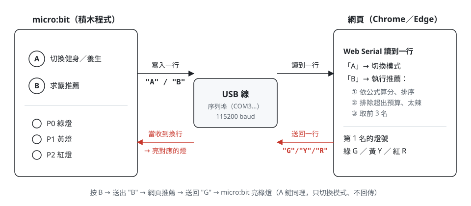
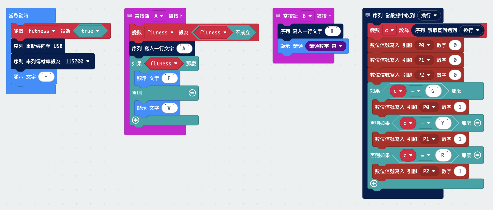
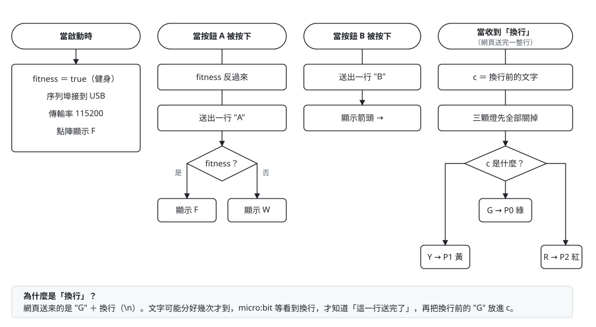

# 學生實作說明書：LED＋A／B 鍵版

> 這份說明書讓學生獨立完成一個簡化版作品：用積木寫 micro:bit 程式，再分步驟請 AI 協助做出推薦網頁。



## 0. 做出來的樣子

- 按 **A**：網頁切換「健身／養生」，micro:bit 點陣顯示 `F`／`W`。
- 按 **B**：網頁依我們的公式從菜單挑出前 3 名，再把第 1 名的燈號送回 micro:bit，亮起綠／黃／紅燈。

| 誰負責 | 做什麼 |
|---|---|
| micro:bit（積木） | 讀按鈕、送出 `A`／`B`；收到 `G`／`Y`／`R` 就亮燈 |
| 網頁（AI 協助寫） | 讀菜單、算分、篩選、取前 3 名，送回燈號 |
| USB 線 | 把兩邊連起來（序列埠，115200） |

## 1. 材料與接線

| 零件 | 數量 |
|---|---|
| micro:bit（V1 或 V2）＋擴充板 | 1 |
| 可傳資料的 USB 線 | 1 |
| LED（紅、黃、綠） | 各 1 |
| 電阻 100Ω～220Ω | 3 |
| 麵包板、杜邦線 | 若干 |

- 綠燈接 **P0**、黃燈接 **P1**、紅燈接 **P2**。
- LED 長腳（+）→ 電阻 → P0／P1／P2；短腳（−）→ **GND**。
- 不要把 LED 接到 3V，不然會一直亮、程式控制不了。
- A、B 鍵用 micro:bit 板子上的，不用另外接。

接線圖見 [01_base_leds.svg](images/wiring/01_base_leds.svg)。

## 2. micro:bit 積木程式

### 2.1 建構積木程式

1. 打開 https://makecode.microbit.org → **新增專案**。
2. 開始建構程式，也可以參考下圖範例。



如果還是做不出來，你可以點擊 makecode 介面上方的 **JavaScript** 分頁，刪掉裡面原本的內容，貼上下面這段程式。
點上方的 **積木** 分頁切回來，就會變成彩色積木。

```javascript
let fitness = true
let c = ""
serial.redirectToUSB()
serial.setBaudRate(BaudRate.BaudRate115200)
basic.showString("F")

// 按 A：切換健身／養生，並告訴網頁
input.onButtonPressed(Button.A, function () {
    fitness = !fitness
    serial.writeLine("A")
    if (fitness) {
        basic.showString("F")
    } else {
        basic.showString("W")
    }
})

// 按 B：請網頁推薦
input.onButtonPressed(Button.B, function () {
    serial.writeLine("B")
    basic.showArrow(ArrowNames.East)
})

// 收到網頁送來的燈號：G 綠、Y 黃、R 紅
serial.onDataReceived(serial.delimiters(Delimiters.NewLine), function () {
    c = serial.readUntil(serial.delimiters(Delimiters.NewLine))
    pins.digitalWritePin(DigitalPin.P0, 0)
    pins.digitalWritePin(DigitalPin.P1, 0)
    pins.digitalWritePin(DigitalPin.P2, 0)
    if (c == "G") {
        pins.digitalWritePin(DigitalPin.P0, 1)
    } else if (c == "Y") {
        pins.digitalWritePin(DigitalPin.P1, 1)
    } else if (c == "R") {
        pins.digitalWritePin(DigitalPin.P2, 1)
    }
})
```

### 2.2 看懂每一塊積木



| 積木 | 作用 |
|---|---|
| 當啟動時 → 序列 重新導向至 USB、傳輸率 115200 | 讓 micro:bit 透過 USB 線和電腦講話，速度要和網頁一樣 |
| 變數 `fitness` 設為 true | 記住現在是健身（true）還是養生（false） |
| 當按鈕 A 被按下 → `fitness` 設為「非 `fitness`」 | 健身↔養生互換；同時送出 `A` 告訴網頁 |
| 當按鈕 B 被按下 → 寫入一行文字 `B` | 請網頁推薦 |
| 序列 當數據中收到 換行 | 網頁送來一行字時會觸發這裡 |
| 變數 `c` 設為「讀取直到遇到 換行」 | `c` 暫存網頁送來的字母（G／Y／R）；可以改名成「燈號」 |
| 先把 P0、P1、P2 都寫 0，再依 `c` 亮一顆 | 確保一次只亮一顆燈 |

### 2.3 先測試積木（還不用網頁）

1. 按 **下載**，得到一個 `.hex` 檔。
2. 把 `.hex` 拖進電腦上的 **MICROBIT** 磁碟，等背面黃燈閃完。
3. 點 MakeCode 模擬器下方的 **顯示資料 裝置**，按 A、B，畫面上應該會出現 `A`、`B`。

> 燒錄時**不要按 MakeCode 的「配對裝置」**。配對後瀏覽器會佔住 micro:bit，下一步驟的網頁就收不到資料。強烈建議用「下載 → 拖進磁碟」的方式較為穩定。

## 3. 網頁：分 5 步請 AI 協助

### 3.1 準備

- **AI 工具**：Gemini、ChatGPT 或 Claude 都可以，選有「Canvas／預覽 HTML」功能的。
- **菜單資料**：老師提供 `data/raw` 當中的 csv 檔。
- **規則**：**一次只做一步**。每一步都要實際測試、看懂程式在做什麼，再進下一步。

### 3.2 五個 prompt

把下面的文字複製給 AI。公式和燈號門檻可以換成你們自己設計的。同時建議將此份說明書 md 檔一併提供給 AI 讓他不用猜測理解我們的專案架構。

**Prompt 1：讀菜單**

```text
幫我做一個單一 HTML 檔的網頁，不要用任何框架。網頁上有一個「選擇檔案」按鈕，
可以讀入我們的菜單 CSV 檔，然後用表格把所有餐點顯示出來。
欄位有：餐廳、餐點名稱、價格區間、主餐類型、辣度、油脂加權、蛋白質加權、鹽分加權、澱粉加權、烹調加權。
程式碼請加上中文註解，要讓國小五年級學生看得懂。
```

✅ 檢查：表格的筆數和 CSV 一樣嗎？中文有沒有變亂碼？

**Prompt 2：算分數**

```text
加一個「健身／養生」切換按鈕。每道菜依模式算分數：
健身分數 = 油脂×2 + 蛋白質×3 + 鹽分×1 + 澱粉×1
養生分數 = 油脂×1 − 辣度×1 + 鹽分×1 + 澱粉×1 + 烹調×3
在表格加一欄「分數」，並依分數從高到低排序。
```

✅ 檢查：挑 2、3 道菜**用紙筆手算**，和網頁的分數一樣嗎？

**Prompt 3：照我們的流程圖篩選**

```text
照我們的流程圖：先計分排序，再依序排除「超出預算」、「超出可接受辣度」的餐點，最後取前 3 名。
畫面上加預算選項（100 以下、101-300、301-500、500 以上、不限）
和辣度選項（不辣、1～5、都可以）。
用三張卡片顯示前 3 名，並在畫面上寫出每一步剩下幾道菜。
```

✅ 檢查：把預算調低、辣度調成「不辣」，剩下的道數有變少嗎？前 3 名真的符合條件嗎？

**Prompt 4：紅黃綠燈**

```text
每道菜依分數給燈號：
健身模式：13 分以上綠燈、9 到 12 分黃燈、其餘紅燈；
養生模式：8 分以上綠燈、4 到 7 分黃燈、其餘紅燈。
卡片上用顏色加文字標出燈號。
```

✅ 檢查：分數剛好在門檻上（例如 13 分、9 分）的菜，燈號對嗎？

**Prompt 5：連接 micro:bit**

```text
加一個「連接 micro:bit」按鈕，用 Chrome 的 Web Serial（鮑率 115200）連線。
micro:bit 每次送來一行文字：收到 A 就切換健身／養生；
收到 B 就執行推薦，並把第 1 名的燈號送回 micro:bit
（綠燈送 G、黃燈送 Y、紅燈送 R，每個字母後面加換行）。
```

✅ 檢查：按 micro:bit 的 A，網頁模式有切換嗎？按 B，網頁有推薦、燈有亮嗎？

### 3.3 卡住時怎麼問 AI

把**你做了什麼、看到什麼、預期是什麼**一起告訴 AI，例如：

```text
我按了 micro:bit 的 B 鍵，網頁有出現推薦，但 micro:bit 的燈沒有亮。
我的積木是收到 G 就讓 P0 寫入 1。請幫我檢查網頁送回燈號的程式。
```

## 4. 實際執行

1. 在 AI 工具裡把 HTML **下載**成檔案（例如 `menu.html`）。
2. 用**電腦版 Chrome 或 Edge** 直接打開這個檔案。AI 工具裡的預覽畫面不能連 micro:bit。
3. 按「選擇檔案」載入菜單 CSV。
4. 按「連接 micro:bit」，在跳出的清單選 micro:bit（Windows 會顯示 `mbed Serial Port (COMx)`）。
5. 按 micro:bit 的 A、B 測試。

## 5. 疑難排解

| 狀況 | 處理 |
|---|---|
| 切回積木時出現灰色積木 | 那段程式沒有對應的積木；重新貼上 2.1 的程式，或照 2.2 自己拖積木 |
| 按「連接 micro:bit」沒有出現清單 | 要用電腦版 Chrome／Edge；Safari、Firefox、手機都不支援 |
| 清單裡選了 micro:bit 卻連不上 | 關掉 MakeCode 分頁和其他連著 micro:bit 的網頁，拔插 USB 再試 |
| 按 A、B 網頁沒反應 | 確認積木的傳輸率是 115200；在 MakeCode「顯示資料 裝置」看有沒有送出 A、B |
| 網頁有推薦，但燈不亮 | LED 長短腳方向、電阻是否插好；網頁送回的字母是否加了換行 |
| micro:bit 自己一直重開 | 檢查是否把「寫入一行文字」放進了「重複無限次」 |

## 6. 做完之後可以再加什麼

1. **蜂鳴器**：在「收到換行」裡加音樂積木，綠燈嗶兩聲、紅燈嗶三聲。
2. **健康指針**：網頁多送一個分數（例如 `S75`），micro:bit 用伺服馬達積木轉到對應角度。
3. **外接按鈕、旋鈕**：建議用 micro:bit **V2**（V1 用積木做會不穩定）。
